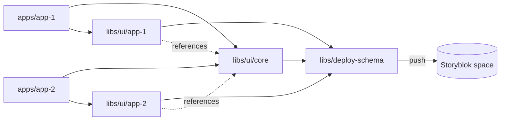

# Monorepo


This repo is an [Nx](https://nx.dev) workspace. Nx runs the tasks for each app and library. See [What is Nx?](https://nx.dev/docs/getting-started/intro).

To see the projects and their dependencies, run `npx nx graph`. To list the tasks of one project, run `npx nx show project <name>`.

Two Next.js apps render content from one Storyblok space. Libraries define the block schemas in TypeScript.

## Getting started

1. Install dependencies:

   ```sh
   npm install
   ```

2. Copy `apps/app-N/.env.example` to `apps/app-N/.env.local`. Set `STORYBLOK_API_KEY` to a preview access token from the space.
3. Start an app:

   ```sh
   npx nx dev @monorepo/app-1
   ```

   The dev server uses HTTPS with a self-signed certificate. Accept the browser warning.

4. To use the Visual Editor, follow [Visual Preview in Next.js](https://www.storyblok.com/docs/guides/nextjs/visual-preview).
5. Log in to the Storyblok CLI before you push a schema:

   ```sh
   npx storyblok login
   ```

## Project layout



app-1 and app-2 contain only routing, data fetching and `storyblokInit`. The blocks, schemas and components are in libraries. See [Nx: Keep applications thin](https://nx.dev/docs/kb/folder-structure).

Each app uses two libraries: `ui-core` and its own app library. app-1 uses `ui-app-1`. app-2 uses `ui-app-2`. The page block of each app allows the `ui-core` blocks, so editors can add them to the pages of both apps.

## Schemas in this monorepo

Each block is a TypeScript definition. The Storyblok CLI pushes the definitions to the space. See [Storyblok Schema](https://www.storyblok.com/docs/libraries/js/schema) and [`schema push`](https://www.storyblok.com/docs/tooling/cli/schema/push).

- Each library owns the schema and components for its blocks. Apps own no schema.
- App libraries reference `ui-core` folders in `allow` lists.
- Block and folder names must be unique in the space. Add the app name to the name of each app block and folder. Example block: `app_2_hero`. Example folder: `App 2 Components`.
- `deploy-schema` merges the schemas of `ui-core`, `ui-app-1` and `ui-app-2` and pushes them to the space in one run. The UI libraries do not push.
- To add a new UI library, import its schema in `libs/deploy-schema/src/schema/schema.ts`.
- Because `deploy-schema` holds every block, `schema push --delete` removes only blocks that no library defines. That includes blocks someone created in the Storyblok UI. Run the dry run first.

### Example: Add a block to app-2

1. Define the block in `libs/ui/app-2/src/schema/blocks/` with the `app_2_` prefix. Add it to `libs/ui/app-2/src/schema/schema.ts`.
2. Write its component in `libs/ui/app-2/src/lib/storyblok/`. The app needs no change.
3. Validate the library, then push from `deploy-schema`:

   ```sh
   npx nx run ui-app-2:schema:validate
   npx nx run deploy-schema:schema:push:dry
   npx nx run deploy-schema:schema:push
   ```

## Commands

| Command                                    | Effect                          |
| ------------------------------------------ | ------------------------------- |
| `npx nx dev @monorepo/app-1`               | Start app-1                     |
| `npm run dev`                              | Start all apps                  |
| `npx nx run <lib>:schema:validate`         | Validate a library schema       |
| `npx nx run deploy-schema:schema:push:dry` | Show the diff against the space |
| `npx nx run deploy-schema:schema:push`     | Apply the diff                  |

`<lib>` is `ui-core`, `ui-app-1`, `ui-app-2` or `deploy-schema`.
